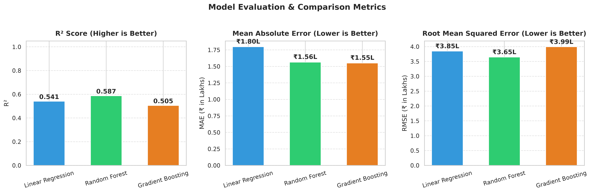
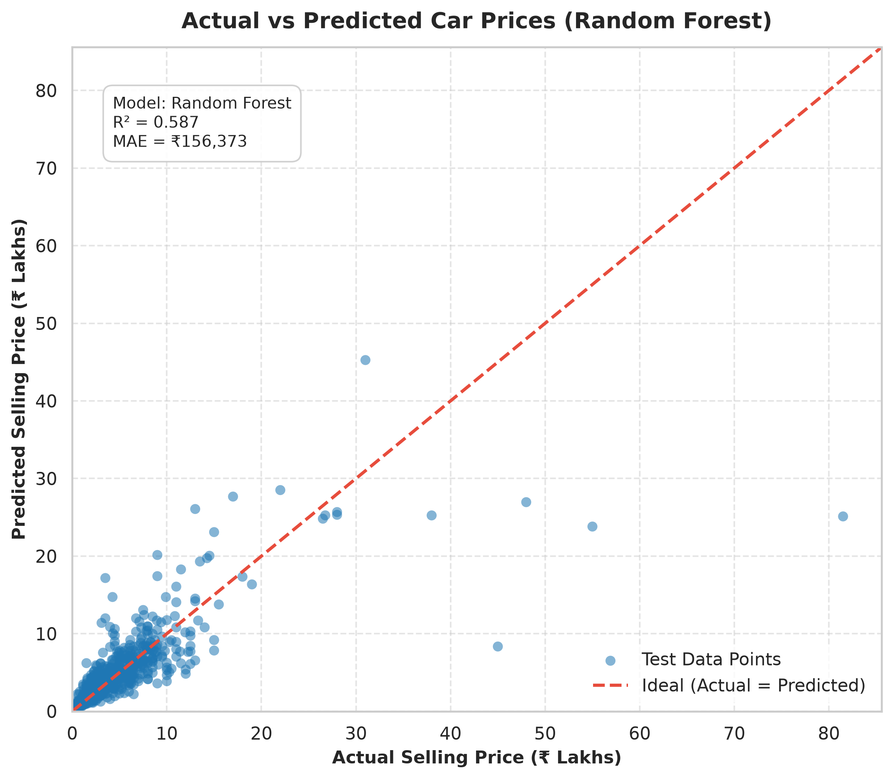
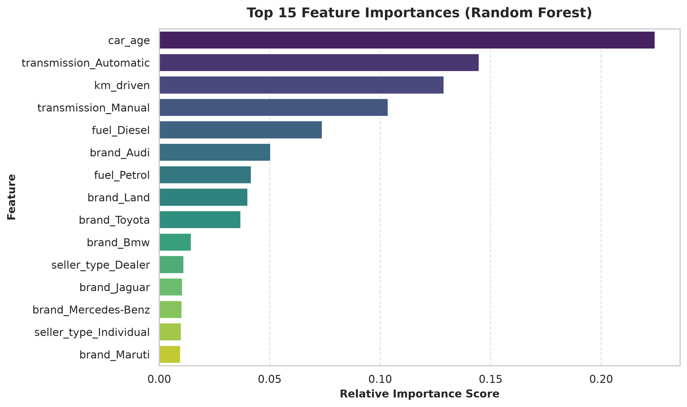
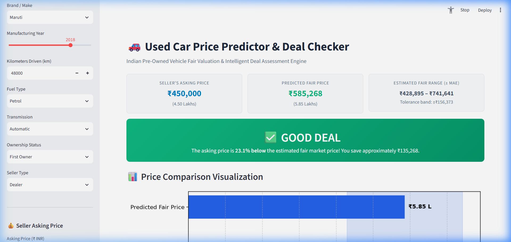

# 🚗 Used Car Price Predictor & Deal Checker (Indian Market)

A clean, beginner-friendly yet production-ready Machine Learning project that predicts fair market prices for used cars in India and classifies deals into **Good Deal**, **Fair Deal**, or **Overpriced**.

---

## 📌 1. Problem Statement
The Indian used car market is rapidly growing, but pricing remains largely fragmented, subjective, and opaque. Buyers often wonder whether a seller's asking price is a genuine bargain or an inflated markup, while sellers struggle to estimate an optimal listing price.

This project solves this by:
1. Training machine learning models on real Indian pre-owned automobile transactions.
2. Predicting an unbiased fair market value along with an error tolerance band (± MAE).
3. Providing an instant **Deal Verdict**:
   - 🟢 **Good Deal**: Asking price > 10% below predicted fair price.
   - 🟡 **Fair Deal**: Asking price within ±10% of predicted fair price.
   - 🔴 **Overpriced**: Asking price > 10% above predicted fair price.
4. Enabling dynamic **"What-If" Sensitivity Analysis** to visualize how price depreciates with kilometers driven and vehicle age.

---

## 📊 2. Dataset Source
This project uses the well-known **CarDekho Indian Used Car Dataset** (publicly available without authentication).

- **Source URL**: [CarDekho Public Dataset on GitHub](https://raw.githubusercontent.com/IMvision12/Car-Price_prediction/main/CAR%20DETAILS%20FROM%20CAR%20DEKHO.csv) (original Kaggle CarDekho repository)
- **Entries**: 4,340 rows
- **Raw Features**:
  - `name`: Vehicle make and model (e.g., *Maruti Swift Dzire VDI*, *Hyundai Verna 1.6 SX*)
  - `year`: Manufacturing year
  - `selling_price`: Transaction price in Indian Rupees (₹)
  - `km_driven`: Total kilometers accumulated on odometer
  - `fuel`: Petrol, Diesel, CNG, LPG, Electric
  - `seller_type`: Individual, Dealer, Trustmark Dealer
  - `transmission`: Manual, Automatic
  - `owner`: First Owner, Second Owner, Third Owner, Fourth & Above Owner, Test Drive Car

---

## 📁 3. Project Directory Structure
```text
ml/
├── data.csv                 # Raw used car transaction dataset (CarDekho)
├── train.py                 # Training pipeline, model comparison & artifact generator
├── app.py                   # Streamlit web application & deal checker
├── requirements.txt         # Required Python dependencies
├── model.pkl                # Trained scikit-learn best model pipeline (saved after training)
├── metrics.json             # Serialized evaluation metrics & metadata
├── model_comparison.png     # Benchmark chart comparing R2, MAE, and RMSE
├── actual_vs_predicted.png  # Parity scatter plot of actual vs predicted prices
├── feature_importance.png   # Bar chart showing key price drivers
└── README.md                # Project documentation
```

---

## ⚙️ 4. Quickstart: How to Run

### Step 1: Clone or Navigate to the Directory
```bash
cd /path/to/ml
```

### Step 2: Install Dependencies
```bash
pip install -r requirements.txt
```

### Step 3: Run the Training Script
```bash
python train.py
```
This script will:
- Clean the data (drop duplicate rows and missing values).
- Extract vehicle `brand` and calculate `car_age`.
- Train and benchmark **Linear Regression**, **Random Forest**, and **Gradient Boosting**.
- Save the 3 diagnostic plots (`model_comparison.png`, `actual_vs_predicted.png`, `feature_importance.png`).
- Export the best performing pipeline to `model.pkl`.

### Step 4: Launch the Streamlit App
```bash
streamlit run app.py
```
The app will open automatically in your browser at `http://localhost:8501`.

---

## 🔬 5. Machine Learning Methodology

### 1. Data Cleaning & Feature Engineering
- **Duplicates**: Removed redundant listings to prevent data leakage.
- **Brand Extraction**: Extracted manufacturer name from `name` (e.g., `Maruti`, `Hyundai`, `Honda`, `Toyota`).
- **Car Age**: Calculated `car_age = 2024 - year` to give models a linear depreciation metric.
- **Data Filtering**: Filtered out non-positive prices and anomalous odometer entries.

### 2. Preprocessing Pipeline (`scikit-learn`)
- **Numerical Features** (`car_age`, `km_driven`): Scaled using `StandardScaler()`.
- **Categorical Features** (`brand`, `fuel`, `seller_type`, `transmission`, `owner`): Encoded using `OneHotEncoder(handle_unknown='ignore')`.
- All steps bundled using `ColumnTransformer` and scikit-learn `Pipeline` to eliminate data leakage.

### 3. Model Benchmark
We train and evaluate three distinct algorithms on an 80/20 train-test split:
1. **Linear Regression**: Baseline parametric model.
2. **Random Forest Regressor**: Non-linear ensemble model capturing complex interactions.
3. **Gradient Boosting Regressor**: Sequentially optimized decision trees.

---

## 📈 6. Evaluation Results

Below is the performance summary across the test split:

| Model | $R^2$ Score | Mean Absolute Error (MAE) | Root Mean Squared Error (RMSE) |
| :--- | :---: | :---: | :---: |
| **Linear Regression** | 0.5405 | ₹1,79,642 (~₹1.80L) | ₹3,84,723 (~₹3.85L) |
| **Random Forest Regressor** (Best) | **0.5869** | **₹1,56,373 (~₹1.56L)** | **₹3,64,805 (~₹3.65L)** |
| **Gradient Boosting Regressor** | 0.5053 | ₹1,55,084 (~₹1.55L) | ₹3,99,216 (~₹3.99L) |

*Note: The best performing pipeline (**Random Forest**) is automatically serialized into `model.pkl`.*

---

## 🖼️ 7. Diagnostic Plots & Visualizations

### 1. Model Comparison (`model_comparison.png`)
Bar chart showing side-by-side $R^2$, MAE (₹ Lakhs), and RMSE (₹ Lakhs) across all 3 candidate models.



### 2. Actual vs. Predicted Prices (`actual_vs_predicted.png`)
Scatter plot comparing model predictions against ground truth transaction values, with a 45-degree reference line.



### 3. Feature Importance (`feature_importance.png`)
Top influential features affecting used car pricing (e.g., transmission type, vehicle age, diesel engine, brand prestige).



### 4. Interactive Web Application Interface (`app_screenshot.png`)
Live evaluation view showing user inputs, predicted fair price range, dynamic deal verdict badge, comparison chart, and what-if sensitivity plots.



---

## ⚠️ 8. Real-World Limitations
1. **City & Regional RTO Variations**: In India, road tax (RTO), state taxes, and regional demand cause noticeable price divergence between cities (e.g., Bangalore road tax is significantly higher than Delhi or Chandigarh).
2. **Mechanical & Cosmetic Condition**: The dataset does not include vehicle health indicators (dents, repainted panels, tire wear, service history, or insurance status).
3. **Trim & Variant Nuances**: Variations between base models (e.g., LXi/Era) and top-end variants (e.g., ZXi+/Asta with sunroof) are aggregated under brand-level representations.

---

## 🚀 9. Future Work
- [ ] Add city/state location input to capture regional tax differences.
- [ ] Incorporate specific car models and sub-variants (e.g., Swift Dzire VXi vs Honda City ZX).
- [ ] Integrate computer vision for vehicle damage and scratch inspection from photos.
- [ ] Deploy live onto Streamlit Community Cloud or Hugging Face Spaces.
